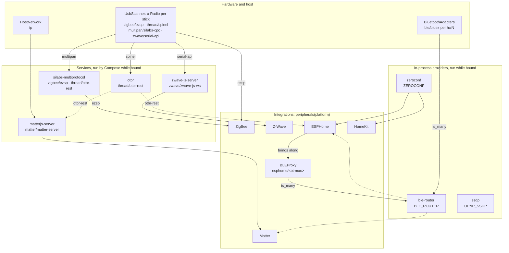

# Peripherals and Services

An integration never opens `/dev/ttyUSB0` itself or reads a server URL from an environment variable. It declares what it needs, and the Hub hands it an address, or an object, once something can serve that need. The Hub finds the USB sticks, recognises their firmware, runs the services between radios and integrations and the peripherals it keeps in its own process (the Bluetooth router, DNS-SD, SSDP), and binds them together. Moving from one stick to another, or to a multi-PAN radio, needs no change in your code.

The language lives in the SDK ([`majordom_integration_sdk.peripherals`](https://github.com/MajorDom-Systems/integration-sdk/tree/develop/majordom_integration_sdk/peripherals): `Peripheral`, `Need`, `Endpoint`, `Service`, `Peripherals`, `PeripheralChange`). The side that binds them is the SDK runtime, `majordom_integration_sdk.runtime` (the `runtime` extra), which the Hub and the standalone runner run; see [The SDK Runtime](../hub/radios.md) for how it works inside.

## Peripherals

Everything around an integration, and the integration itself, is a `Peripheral`: a USB radio, the host's Bluetooth adapters and network, a container, an in-process provider (the Bluetooth router, Zeroconf, SSDP), a controller, an ESPHome node's Bluetooth proxy. Only the construction differs. Each one:

- `needs` capabilities and finds what they are bound to in `self.peripherals`;
- `provides` endpoints, and the peripherals it brings along while it runs (the USB scanner a `Radio` per stick, ESPHome a `BLEProxy` per node);
- has a `key`, unique and stable: its `name`, after its contributor's key for one brought along (`usb/<stick>`, `esphome/<bt-mac>`);
- gets `self.platform`, `self.output` and `self.settings` from the runtime.

The runtime runs a peripheral once every required need is bound to a provider that runs. An `is_on_demand` one (services, providers) runs only while something that runs binds it. The integration package exports its peripherals from `peripherals(platform)`: its controller, the services it brings, and any `UsbDriver`.

How the runtime binds the SDK's and the integrations' peripherals (dotted: optional needs of integrations and services):



## Capabilities

A capability is a `family/dialect` pair. The family says what it is (`zigbee`, `thread`); the dialect says how to talk to it (`ezsp`, `otbr-rest`). A dialect names the exact protocol or API, after its spec or the implementation that defines it (an upstream server, or a library: `mdns/zeroconf` is a browser over python-zeroconf), so one client library implements it. It is never a transport word (`uart`, `serial`, `ws`, `tcp`): the transport is the URL scheme (`/dev/…`, `socket://`, `ws://`, `http://`).

| Capability | What it is | Offered by | Used by |
|---|---|---|---|
| `zigbee/ezsp` | Silicon Labs EmberZNet | a Silicon Labs stick with Zigbee firmware, or the `silabs-multiprotocol` service | Zigbee |
| `zigbee/znp`, `zigbee/deconz`, `zigbee/xbee`, `zigbee/zigate`, `zigbee/ziggurat`, `zigbee/blz`, `zigbee/cc` | other Zigbee coordinators | a stick the Zigbee integration's `ZigpyDriver` recognises | Zigbee |
| `thread/spinel` | a Thread radio (RCP) | a Silicon Labs stick with Thread firmware | `otbr` service |
| `thread/otbr-rest` | a Thread border router's REST API (shared) | `otbr` or `silabs-multiprotocol` service | `matterjs-server` (optional), ESPHome (optional) |
| `multipan/silabs-cpc` | a Silicon Labs multi-PAN radio | a Silicon Labs stick with multi-PAN firmware | `silabs-multiprotocol` service |
| `matter/matter-server` | matterjs-server's API; the URL is its base (`ws://localhost:5580`), with the WebSocket API at `/ws` and the BLE proxy at `/ble` | `matterjs-server` service | Matter |
| `zwave/serial-api` | a Z-Wave controller (Serial API) | any Z-Wave stick | `zwave-js-server` service |
| `zwave/zwave-js-ws` | zwave-js-server's WebSocket API | `zwave-js-server` service | Z-Wave |
| `ip` | the hub's network (shared) | the host | `matterjs-server` |
| `ble/router` | the [Bluetooth router](discovery/ble.md): every radio, one API (shared) | the runtime, in-process | Matter, ESPHome (optional) |
| `ble/bluez` | one Bluetooth adapter of the hub (`hci0`, `hci1`, …), each its own endpoint | the host | the router; `matterjs-server` while the router is disabled |
| `ble/silabs-cpc-hci` | the Bluetooth of a multi-PAN radio, when its firmware has it | a Silicon Labs stick with multi-PAN firmware | the router |
| `ble/esphome-proxy` | an ESPHome node's Bluetooth proxy | the ESPHome integration, a [`BLEProxy`](#bringing-peripherals-along) per node | the router |
| `mdns/zeroconf` | [DNS-SD over mDNS](discovery/zeroconf.md) (shared) | the runtime, in-process | HomeKit, ESPHome |
| `upnp/ssdp` | [SSDP](discovery/ssdp.md) (shared) | the runtime, in-process | — |

`silabs-multiprotocol` runs one multi-PAN stick as both a Zigbee coordinator and a Thread border router. `otbr` is a border router on a plain Thread stick. Both come with the SDK runtime; `matterjs-server` and `zwave-js-server` come with the Matter and Z-Wave integrations. `ble/majordom` is kept for a future MajorDom Bluetooth chip.

## Needs

A need is what a peripheral requires from its environment: a dependency something else (a radio, a server, the hub's network, the Bluetooth router, Zeroconf) must provide. Declare everything external as one.

```python
@dataclass(frozen=True)
class Need[T = Any]:
    family: str
    dialects: Sequence[str] = ()  # empty: any dialect of the family
    is_required: bool = True
    is_many: bool = False
```

- `Need("matter", ["matter-server"])` accepts only the listed dialects. List every dialect your client speaks: Zigbee lists every zigpy radio library's (`ZIGPY_DIALECTS`) and reads the bound one from `self.peripherals.endpoint("zigbee").dialect`.
- `Need("ip")`, with no dialects, accepts any: only for what the host shares.
- `is_many=True` binds every matching endpoint that is free, as a list (`self.peripherals.endpoints(family)`). The Bluetooth router needs raw Bluetooth this way, to hear through every radio.
- `T` types the in-process peripheral it binds. Use the SDK's typed needs for the runtime's providers: `BLE_ROUTER`, `ZEROCONF`, `UPNP_SSDP` (`majordom_integration_sdk.capabilities`), read with `self.peripherals.instance(BLE_ROUTER)`.

A need is **required** by default. The runtime starts the peripheral only once every required need is bound, and stops it when one is lost. Meanwhile the Hub reports the integration as waiting.

An **optional** need (`is_required=False`, or `dataclasses.replace(BLE_ROUTER, is_required=False)`) doesn't hold it back. The runtime binds it when it can. Until then it is missing from `self.peripherals`.

An unbound need carries the reason, for the user and for you: `need zigbee/ezsp|znp|…: nothing offers it`, or, when what took the endpoint provides the same family itself, what to need instead: `need ble/bluez: every provider taken by ble-router — use Need("ble", ["router"])`. The Hub shows it on the integration (`unbound` in [`GET /v1/api/integrations`](../hub/radios.md#rest-api)); standalone, the runner logs it.

## Endpoints

```python
@dataclass(frozen=True)
class Endpoint:
    family: str
    dialect: str = ""
    url: str = ""
    is_shared: bool = False
    params: Mapping[str, Any] = field(default_factory=dict)
    instance: Any = None  # not compared
```

An endpoint is what a radio, a service, the host, the runtime or another integration provides, and what your controller receives in `self.peripherals`. `url` is what you connect to: a serial path (`/dev/serial/by-id/usb-…`), a TCP socket (`socket://127.0.0.1:9999`) or a WebSocket base (`ws://127.0.0.1:5580`). `params` says how to talk to it, e.g. a serial port's `baud` and `flow_control`, or a host adapter's `index`.

`instance` carries an in-process peripheral itself: the Bluetooth router, the DNS-SD browser, an ESPHome node's Bluetooth source. `url` still names it (`router`, an `hciN`), and two endpoints are the same when all but the instance match. Read it with `self.peripherals.instance(need)`.

- **Exclusive** (the default): one consumer only. A serial port opens once, so a stick's endpoints are exclusive.
- **Shared**: any number of consumers. One border router serves both Matter and ESPHome; `ip` serves everyone.

The runtime binds in the order it was given, what each peripheral brings along right after it: pinned endpoints, soldered hardware, the SDK's defaults (USB sticks, host, Compose, border routers, the Bluetooth router, Zeroconf, SSDP), then the integrations. The first consumer of an exclusive endpoint takes it, so the router, which needs every raw Bluetooth adapter, gets them all. A need is served by the first provider that can.

### In-process providers

The runtime runs the Bluetooth router (`ble/router`), Zeroconf (`mdns/zeroconf`) and SSDP (`upnp/ssdp`) in its own process, and provides each as a shared endpoint with its `instance`. Need them by their typed needs:

```python
from majordom_integration_sdk.capabilities import BLE_ROUTER, ZEROCONF

needs = [ZEROCONF, replace(BLE_ROUTER, is_required=False)]

async def start(self):
    self._cancel = self.peripherals.instance(ZEROCONF).register(self, {"_myprotocol._tcp.local."})
    if router := self.peripherals.instance(BLE_ROUTER):  # None on a hub without Bluetooth
        self._cancel_ble = router.register(self, [MY_SERVICE_UUID])
```

Their contracts (`Zeroconf`, `SSDP`, `BLERouter`, …) are in `majordom_integration_sdk.capabilities`; see [Discovery Services](discovery/index.md).

### Bringing peripherals along

A peripheral's `provides` may hold peripherals as well as endpoints: they run while it does, keyed after it. When it changes on its own, tell the output (`controller_did_change_provided` from a controller). ESPHome brings a `BLEProxy` per node with `bluetooth_proxy`, keyed `esphome/<bt-mac>`; the router binds it as `ble/esphome-proxy` and hears through it.

```python
self._proxies[device_id] = BLEProxy(source, name=source.mac)
await self.output.controller_did_change_provided(self)
```

## Bringing your own service

```python
class Service[S: BaseModel = Any](Peripheral[S]):
    def __init__(
        self,
        name: str,
        compose: ComposeService,
        needs: Sequence[Need] = (),
        provides: Sequence[Endpoint] = (),
        settings: type[S] = NoSettings,
        ports: Mapping[str, int] | None = None,  # name -> preferred host port
    ): ...
```

A service is a companion server an integration brings along. When your protocol runs behind a server (Matter behind matterjs-server, Z-Wave behind zwave-js-server), return a `Service` from `peripherals(platform)` next to the controller, and need what it provides. It is on demand: the runtime runs it only while something that runs is bound to one of its endpoints. Build a new one per call: the runtime keeps its state on the instance.

`compose` is the service's [Docker Compose](https://docs.docker.com/reference/compose-file/services/) definition, typed as `ComposeService`: image, environment, volumes, and so on. The runtime adds `restart: unless-stopped` and runs it in the `majordom` Compose project. There's no `depends_on`: every service retries until the endpoints it needs answer. Pin the image by digest so an upstream release can't change what runs.

Strings in `compose` are templates:

| Template | Becomes |
|---|---|
| `{data}` | the service's own data folder on the hub; mount it to keep state |
| `{peripherals.<family>.url}` | the URL bound to one of the service's needs, e.g. `{peripherals.zwave.url}` is the stick's path; empty while an optional need is unbound; the first endpoint of an `is_many` need |
| `{peripherals.<family>.params[<name>]}` | a parameter of that endpoint: a serial port's `baud` or `flow_control`, a host Bluetooth adapter's `index`; empty when it has none |
| `{ports.<name>}` | the host port the runtime picked for the service's port `<name>` |
| `{settings.<field>}` | a field of the service's `settings` |
| `{platform.<fact>}` | a platform fact, e.g. `{platform.region}`, the hub's radio region |
| `{host.interface}` | the hub's network interface: a wired one with a link, else the one of the default route |
| `{host.uid}`, `{host.gid}` | the hub's user and group, for a container that should write its data as the hub |
| `{host.listen_address}` | where a host-network service listens: loopback, unless the Hub sets `EXPOSE_SERVICES_ON_LAN` |

A value of `None` renders empty. A format spec renders text by the value: `{x:&uart-flow-control}` renders `&uart-flow-control` when the flag `x` is true, `{x:!true}` renders `true` when `x` is empty, e.g. `"BLE_PROXY": "{peripherals.ble.url:!true}"` turns the proxy on while no adapter is bound, and `{x:?dbus}` renders `dbus` when `x` isn't empty. A list item that renders empty is left out, so `"volumes": ["{data}:/data", "{peripherals.ble.url:?/run/dbus:/run/dbus:ro}"]` mounts the system bus only while an adapter is bound. Write `{{` and `}}` for literal braces. (`{device}`, a stick's path, belongs to the radio drivers in the runtime, not to services.)

The `params` of the endpoints a service `provides` are templates too, rendered the same way. That is how a consumer learns what its service got: matterjs-server provides `params={"adapter": "{peripherals.ble.url}"}`, so Matter reads `self.peripherals.endpoint("matter").params["adapter"]`, empty while no adapter is bound to the service. When it changes, the consumer's `matter` endpoint changes, and the runtime calls [`needed_peripheral_did_change()`](controller.md#hooks).

Run the service on the host network, listening on `{host.listen_address}`, and name the ports it listens on. `ports={"api": 5580}` says which host port it *prefers*, not a fixed one: the runtime uses it when free and otherwise assigns another (45800–45999), keeps the choice across restarts, and fills `{ports.<name>}` in the compose and in the `provides` URLs. Pass the port to the server through `compose` (an environment variable or a command-line argument), and write `{ports.<name>}` in the URLs it provides. See [Matter](#matter-with-its-own-service) for a complete service.

Your integration never reads a port: it connects to `self.peripherals.endpoint(<family>).url`. That URL may not even point at your service. When a server is pinned as the provider, the runtime doesn't run yours and hands over the pinned URL instead, with no change in your code.

## Recognising a stick: `UsbDriver`

The runtime's `UsbScanner` recognises Silicon Labs and Z-Wave sticks itself. For any other stick, it asks the `UsbDriver`s integrations export. `identify(path)` returns the firmware the stick runs, or `None`; `firmwares` maps each firmware to the endpoints it serves (`{device}` is the stick's path). The answer is kept, so it asks once per stick. Only integrations that talk to a radio directly need one.

## Examples

### Zigbee: a radio, directly

Zigbee talks to the coordinator itself through zigpy, so it needs `zigbee` in every dialect zigpy speaks, and exports a driver for the sticks only zigpy tells apart ([`radio.py`](https://github.com/MajorDom-Systems/integration-zigbee/tree/develop/majordom_zigbee/radio.py)):

```python
class ZigpyDriver(UsbDriver):
    name = "zigpy"
    firmwares = {radio.key: [Endpoint("zigbee", radio.key, "{device}")] for radio in PROBED}

    async def identify(self, path: str) -> tuple[str, dict[str, Any]] | None:
        if not (found := await detect({CONF_DEVICE_PATH: path})):
            return None
        radio, config = found
        return radio.key, {"baud": config[CONF_DEVICE_BAUDRATE]}


def peripherals(platform: Platform) -> list[Peripheral]:
    return [ZigpyDriver(), ZigBeeController(platform)]
```

What it gets depends on the stick:

| Stick | `self.peripherals.endpoint("zigbee")` |
|---|---|
| Silicon Labs, Zigbee firmware | `Endpoint("zigbee", "ezsp", "/dev/serial/by-id/usb-…")` |
| Silicon Labs, multi-PAN firmware | `Endpoint("zigbee", "ezsp", "socket://127.0.0.1:9999")`, through the `silabs-multiprotocol` service |
| Texas Instruments, recognised by `ZigpyDriver` | `Endpoint("zigbee", "znp", "/dev/serial/by-id/usb-…")` |

### Matter: with its own service

Matter drives matterjs-server over its WebSocket API, so it brings matterjs-server along as a service ([`config.py`](https://github.com/MajorDom-Systems/integration-matter/tree/develop/majordom_matter/config.py)):

```python
def matterjs_server() -> Service:
    return Service(
        "matterjs-server",
        # Thread is optional: without a border router Matter still works over Wi-Fi and Ethernet. Bluetooth too: the
        # router is in-process and reaches matterjs-server through the controller (over /ble) instead.
        needs=[Need("ip"), Need("thread", ["otbr-rest"], is_required=False), Need("ble", ["bluez"], is_required=False)],
        # the base URL: /ws, /ble; "adapter" tells the controller whether an adapter is bound here (empty: none)
        provides=[
            Endpoint("matter", "matter-server", "ws://127.0.0.1:{ports.api}", params={"adapter": "{peripherals.ble.url}"})
        ],
        ports={"api": 5580},  # preferred: another one when 5580 is taken
        compose={
            "image": "ghcr.io/matter-js/matterjs-server@sha256:…",
            "network_mode": "host",
            "userns_mode": "host",
            "user": "{host.uid}:{host.gid}",  # its data folder belongs to the hub
            "environment": {
                "STORAGE_PATH": "/data",
                "PORT": "{ports.api}",  # the server listens where the runtime says
                "LISTEN_ADDRESS": "{host.listen_address}",  # loopback unless the Hub exposes services on the LAN
                "BLE_PROXY": "{peripherals.ble.url:!true}",  # Bluetooth comes from the hub, unless it has an adapter
                "BLUETOOTH_ADAPTER": "{peripherals.ble.params[index]}",
                "NOBLE_BINDINGS": "{peripherals.ble.url:?dbus}",  # an adapter goes through the host's BlueZ, not as root
            },
            "volumes": [
                "{data}:/data",
                "{peripherals.ble.url:?/run/dbus:/run/dbus:ro}",  # the system bus only with an adapter: gone without one
            ],
        },
    )
```

The controller needs what the service provides and the router, and hands the hub's networks to matterjs-server for commissioning ([`controller.py`](https://github.com/MajorDom-Systems/integration-matter/tree/develop/majordom_matter/controller.py)):

```python
class MatterController(AbstractController):
    # matter: matterjs-server's base URL (its API at /ws, its BLE proxy at /ble);
    # ble: the router, which MatterServerBLEDelegate lends matterjs-server for commissioning
    needs = [Need("matter", ["matter-server"]), replace(BLE_ROUTER, is_required=False)]

    async def start(self):
        ...
        # ws://127.0.0.1:5580, or wherever the server runs: never build the base URL yourself
        self._matter_client = MatterClient(f"{self._server_url}/ws", self._matter_client_session)
        await self._matter_client.connect()
        ...
        # Bluetooth follows the bindings: an adapter of matterjs-server's own, else the router, else none
        if self.peripherals.endpoint("matter").params.get("adapter"):
            await self._offer_commissioning_by_code()
        elif router := self.peripherals.instance(BLE_ROUTER):
            ...  # lent to matterjs-server's /ble
        # Networks new devices get commissioned onto.
        if wifi := self.platform.wifi:
            await self._matter_client.set_wifi_credentials(wifi.ssid, wifi.password)
        if dataset := self.platform.thread_dataset:
            await self._matter_client.set_thread_operational_dataset(dataset)
```

Matter brings matterjs-server (its service) but needs a Thread border router, which it doesn't bring: the SDK runtime does, as its `otbr` service (`silabs-multiprotocol` on a multi-PAN stick). The runtime binds the chain from the controller down:

| Consumer | Needs | Bound to | Gets |
|---|---|---|---|
| `MatterController` | `matter/matter-server` | `matterjs-server`, Matter's own service | `self.peripherals.endpoint("matter").url`: `ws://127.0.0.1:5580`, or another port when 5580 is taken |
| `MatterController` | `ble/router` (optional) | the runtime's router | `self.peripherals.instance(BLE_ROUTER)`, lent to matterjs-server's `/ble` |
| `matterjs-server` | `thread/otbr-rest` (optional) | `otbr`, from the SDK runtime | `{peripherals.thread.url}` in its compose: `http://127.0.0.1:8081` |
| `matterjs-server` | `ble/bluez` (optional) | a free adapter (the router disabled), else unbound | `{peripherals.ble.params[index]}` in its compose; the controller sees it as the `adapter` param of its `matter` endpoint |
| `otbr` | `thread/spinel` | a Thread stick | `{peripherals.thread.url}` in its compose: the stick's path |

A controller that declares `Need("thread", ["otbr-rest"])` itself, as ESPHome does [below](#esphome-an-optional-border-router-and-proxies), finds the same URL in `self.peripherals.endpoint("thread").url`.

`matterjs-server` needs only `ip` to run, so Matter starts on any hub. Its optional Thread need makes the runtime run a border router whenever a stick can serve one. The border router tells the Thread network it formed (`peripheral_did_learn`); the Hub keeps it as `platform.thread_dataset`, and Matter's `platform_facts_did_change()` hands it to matterjs-server.

If a matter-server runs elsewhere, pin it as the `matter` provider. The runtime then doesn't run `matterjs_server()` and hands the controller that server's URL instead.

See [Matter](../integrations/matter.md#bluetooth) for its two Bluetooth modes. Z-Wave follows the same pattern: its `zwave-js-server` service needs `zwave/serial-api` from the stick, listens on `{host.listen_address}`, takes `{platform.region}` and its write-only network keys from `{settings.…}`, and provides `zwave/zwave-js-ws`, which the controller needs ([`config.py`](https://github.com/MajorDom-Systems/integration-zwave/tree/develop/majordom_zwave/config.py)).

### ESPHome: an optional border router, and proxies

ESPHome nodes are found over mDNS. Devices on Thread reach the hub over IP through a border router; Wi-Fi devices need nothing more ([`controller.py`](https://github.com/MajorDom-Systems/integration-esphome/tree/develop/majordom_esphome/controller.py)):

```python
class ESPhomeController(AbstractController[ESPhomeDevice, ESPhomeParameter, "ESPhomeController.Settings"]):
    name = "ESPHome"  # its key, the slug "esphome", scopes its devices
    needs = [
        ZEROCONF,
        Need("thread", ["otbr-rest"], is_required=False),
        replace(BLE_ROUTER, is_required=False),
    ]
```

The controller never reads the Thread endpoint. Declaring it is enough: the runtime runs a border router when a stick can serve Thread, and ESPHome runs either way. Each connected node with `bluetooth_proxy` is [brought along](#bringing-peripherals-along) as a `BLEProxy`, and the router hears through it.

## When a radio comes or goes

- A required need is lost (the stick is unplugged, or switched to other firmware): the runtime stops the peripheral, and the Hub tells the user it resumes when the radio is back. It starts again once the need is bound.
- A bound need appears or moves, or an optional one is lost: the runtime calls [`needed_peripheral_did_change()`](controller.md#hooks). Unless it returns `True`, the runtime restarts the peripheral.
- Settings or platform facts change: the runtime calls `settings_did_change()` or `platform_facts_did_change()`, the same way.
- A service is recreated or crashes: the integration keeps running. Reconnect to it yourself ([Staying connected](controller.md#staying-connected)).

## Without the Hub

Standalone, the dev runner starts the runtime to bind them as the Hub does, or you pass the peripherals yourself. See [Standalone Mode](standalone.md#connecting-to-radios-and-services).
